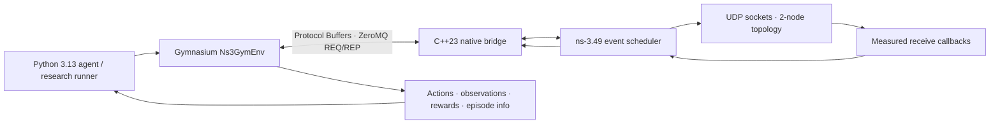

# ns3-gym

**A modern, reproducible ns-3 × Gymnasium bridge for real, Python-controlled network simulation.**

[](https://github.com/vtavakkoli/ns3-gym/actions/workflows/native-ns3.yml)
[](https://www.python.org/)
[](https://www.nsnam.org/)
[](https://isocpp.org/)
[](https://gymnasium.farama.org/)
[](LICENSE)

[](https://cmake.org/)
[](https://protobuf.dev/)
[](https://zeromq.org/)
[](Dockerfile)
[](tests/)
[](.github/workflows/native-ns3.yml)

**ns3-gym** connects a **native, discrete-event ns-3 network simulation** to a **Gymnasium-compatible Python agent** through a versioned **Protocol Buffers / ZeroMQ** interface. The simulator is compiled from an *explicitly pinned* official ns-3 release. End-to-end CI builds the C++ network, runs closed-loop actions from Python, and stores observed network KPIs—rather than treating a successful Python import as simulation evidence.

> [!IMPORTANT]
> **Verified scope:** an actual two-node **UDP traffic-control** experiment using ns-3.49. This project does **not yet provide** 5G NR PHY, O-RAN E2, handover, PRB allocation, or full API/binary compatibility with historical `ns3-gym`. See [scope and limitations](#scope-and-limitations).

## At a glance

| | |
|:--|:--|
| **Native simulator** | [ns-3.49](https://www.nsnam.org/) at `418210e8914e9f6bcb5cddbcc94a2cecb7853b68` |
| **Python API** | `reset(seed=...)` → `(observation, info)`; `step(action)` → `(observation, reward, terminated, truncated, info)` |
| **Language & toolchain** | Python 3.13, C++23, CMake, Ninja, GCC |
| **Interoperability** | ZeroMQ REQ/REP + versioned Protocol Buffers; generated C++ and Python types |
| **Agent interface** | Gymnasium `Discrete`/`Box` spaces; deterministic seeding; explicit failure modes |
| **Lifecycle** | Fresh native process per episode; finite communication deadlines; process/socket cleanup |
| **Reproducibility** | Pinned ns-3 Git SHA, Python dependency constraints, repeatable Docker, automated CI |
| **Verified consumer** | [Agentic-RAN](https://github.com/vtavakkoli/Agentic-RAN) native UDP integration, pinned to a verified ns3-gym commit |

## Architecture



The **Python process** sends `RESET` / `STEP` commands. The **native process** advances the actual ns-3 event scheduler and returns a response derived from its UDP socket callbacks. The new protocol is explicitly versioned; incompatible requests fail instead of silently coercing semantics.

### Current closed-loop contract

| Contract | Verified implementation |
|---|---|
| Topology | Two nodes, 5 Mbps point-to-point link, 2 ms channel delay |
| Action | `Discrete(6)`: transmit **0–5 UDP packets**, 256 bytes each, in the next 100 ms |
| Observation | `Box(3,)` containing `[total_rx_packets, total_tx_packets, step_index]` |
| Reward | **Actually received** UDP packets during the step |
| Info / KPIs | RX/TX packet totals, received bytes, step RX packets, throughput (Mbps), seed, backend |
| Termination | `terminated=True` at configured horizon; `truncated=False` for this example |
| Reset | Fresh simulator process with explicit ns-3 RNG seed |
| Errors | Timeout, invalid action, protocol mismatch, and unsupported backend fail explicitly |

## Quick start

### Recommended: Docker (build + real simulation)

**Requirements:** Docker Engine or Docker Desktop with Linux containers; enough memory for a native ns-3 C++ build.

```bash
git clone https://github.com/vtavakkoli/ns3-gym.git
cd ns3-gym

docker build --progress=plain --build-arg BUILD_JOBS=4 -t vtns3gym:ci .
docker run --rm vtns3gym:ci
```

The Docker build does **more than install dependencies**:

1. Installs CMake/Ninja, ZeroMQ, `protoc`, and the compiler toolchain on `python:3.13-bookworm`.
2. Generates **C++ and Python** sources from the *same* `protocol/gym.proto`.
3. Checks out the official ns-3.49 tag and **verifies its exact commit SHA**.
4. Builds the native ns-3 module and executable using **CMake / C++23**.
5. Installs `vt-ns3-gym` via **`python3.13 -m pip`**.
6. Runs pytest, including **real simulator episodes and timeout/cleanup checks**, and executes the Python-controlled demonstration.

A passing image build therefore indicates the integration tests ran—not just that a Dockerfile parsed.

**Save evidence on the host:**

```bash
mkdir -p evidence
docker run --rm \
  -v "$PWD/evidence:/evidence" \
  -e VTNS3GYM_EVIDENCE=/evidence/native-closed-loop.json \
  vtns3gym:ci
```

The file `evidence/native-closed-loop.json` contains actual observations, commands, rewards, termination flags, and delivered network traffic statistics.

### Python agent API

Inside the built image, or in a Python 3.13 environment with the native executable installed and `VTNS3GYM_BINARY` set:

```python
from vtns3gym import Ns3GymEnv

actions = [0, 1, 4, 2, 5]

with Ns3GymEnv(horizon=len(actions), timeout_seconds=15.0) as env:
    observation, info = env.reset(seed=2026)

    for action in actions:
        observation, reward, terminated, truncated, info = env.step(action)
        print({
            "action": action,
            "observation": observation.tolist(),
            "reward": reward,
            "throughput_mbps": info["throughput_mbps"],
            "rx_packets": info["rx_packets"],
        })
        if terminated or truncated:
            break
```

`Ns3GymEnv` intentionally refuses to start without a **real compiled ns-3 binary**. A Python-only install is **not** a valid simulation backend.

### Develop locally

On Debian Bookworm or a compatible Linux development environment:

```bash
# Native prerequisites: compiler, cmake, ninja, pkg-config,
# libzmq3-dev, libprotobuf-dev, protobuf-compiler, and Git.
bash scripts/generate-proto.sh
python3.13 -m pip install -e ".[test]"
python3.13 -m pytest -q tests
```

**Note:** the native integration tests need `VTNS3GYM_BINARY` pointing to the **compiled ns-3** executable; otherwise they are skipped by local pytest. Use the Docker build or GitHub Actions workflow for the mandatory fully native verification path.

## Verified results

The independent [native GitHub Actions workflow](https://github.com/vtavakkoli/ns3-gym/actions/workflows/native-ns3.yml) has **successfully compiled ns-3.49**, passed **5 tests**, executed a complete native UDP episode, and uploaded a machine-readable evidence artifact.

**Evidence:** [successful main-branch build](https://github.com/vtavakkoli/ns3-gym/actions/runs/45201301175) · [five-step simulation trace](https://github.com/vtavakkoli/ns3-gym/actions/runs/45200326060/artifacts/14832401604).

| Step | Python UDP action | Native observation `[RX, TX, t]` | Reward | Ended? |
|---:|---:|:---:|---:|:---:|
| 1 | 0 | `[0, 0, 1]` | 0 | No |
| 2 | 1 | `[1, 1, 2]` | 1 | No |
| 3 | 4 | `[5, 5, 3]` | 4 | No |
| 4 | 2 | `[7, 7, 4]` | 2 | No |
| 5 | 5 | `[12, 12, 5]` | 5 | **Yes** |

**Observed totals:** 12 packets received, 12 packets transmitted, **3,072 bytes** received. Final-step throughput: **0.1024 Mbps**. These are **UDP packet-delivery results**, not NR scheduling metrics or evidence of a learned agent outperforming a baseline.

The native tests also exercise **multiple sequential episodes**, **fixed-seed reproducibility**, **invalid actions**, and a **nonresponsive subprocess timeout with cleanup**.

## Project structure

```text
ns3-gym/
├── .github/workflows/native-ns3.yml       # mandatory native CI + evidence
├── cpp/
│   ├── contrib/vtns3gym/
│   │   ├── CMakeLists.txt                  # ns-3 CMake integration
│   │   └── model/                          # native ZeroMQ bridge
│   └── scratch/modern-gym-loop.cc          # real UDP network scenario
├── protocol/gym.proto                      # versioned shared wire contract
├── scripts/generate-proto.sh               # C++ / Python protoc generation
├── src/vtns3gym/
│   ├── environment.py                      # Gymnasium lifecycle and transport
│   └── demo.py                             # end-to-end demonstration/evidence
├── tests/                                  # protocol + native closed-loop tests
├── Dockerfile                              # Python 3.13 / pinned ns-3.49
├── pyproject.toml                          # package and Python dependencies
├── ATTRIBUTION.md                          # upstream authors and compatibility
└── LICENSE                                 # GPL-2.0
```

## Versions and provenance

| Component | Version or source |
|---|---|
| ns-3 | **3.49**, Git SHA `418210e8914e9f6bcb5cddbcc94a2cecb7853b68` |
| Python runtime | **3.13** on Debian 12 Bookworm |
| Native standard | **C++23**, as required by pinned ns-3.49 |
| Python distribution | **`vt-ns3-gym==0.1.0`** (this repository) |
| Gymnasium | **1.4.0** |
| PyZMQ | **27.1.0** |
| Protocol Buffers (Python) | `>=6.31,<7`; generated at build time with system `protoc` |
| NumPy | `>=2.2,<3` |
| Linux packages | Debian Bookworm's `libzmq3-dev`, `libprotobuf-dev`, `protobuf-compiler` |
| Verified downstream revision | Agentic-RAN pins ns3-gym commit `21e68565a6beaf13589fd19778b5332f4d0b29e0` |

Refer to [`pyproject.toml`](pyproject.toml), [`Dockerfile`](Dockerfile) and the CI build logs for the complete dependency resolution. The version constraints are recorded; **not every transitive dependency is checksum-locked**.

## Scope and limitations

- **Implemented and tested:** a real ns-3.49 UDP network, Gymnasium reset/step, synchronous ZeroMQ/Protobuf communication, deterministic resets, finite timeouts, safe process termination, and actual packet/KPI reporting.
- **Not implemented:** generic plug-and-play compatibility with the historical `OpenGymInterface`/`SimInitMsg` binary protocol; comprehensive migration of its original example catalog.
- **Not a physical RAN scheduler:** no 5G NR PHY, O-RAN E2 traffic steering, handover, slice scheduler, or PRB actions. An NR experiment needs a new native scenario and verified action-to-simulator mapping.
- **No silent fallback:** unsupported native capabilities or missing compiled binaries produce explicit failures; this repository does not invent network observations.

For a research integration that **preserves those boundaries**, see [Agentic-RAN's modern ns3-gym guide](https://github.com/vtavakkoli/Agentic-RAN/blob/main/docs/DOCKER_MODERN_NS3_GYM.md).

## Contributing, attribution, and license

Issues and pull requests are welcome, particularly for additional **real ns-3** scenarios, protocol compatibility adapters with documented semantics, cross-platform build reproducibility, and native integration tests.

This is an **independent GPL-2.0-only implementation** informed by [the original ns3-gym project](https://github.com/tkn-tub/ns3-gym), originally developed by Piotr Gawłowicz and contributors. The original architecture and its legacy API are acknowledged in [ATTRIBUTION.md](ATTRIBUTION.md); the old implementation is **not** a runtime dependency.

Distributed under the [GNU General Public License v2](LICENSE). See [license and attribution](ATTRIBUTION.md) before redistributing modified integrations.

---

**Built for reproducible network-simulation research: real packets, explicit semantics, inspectable evidence.**
